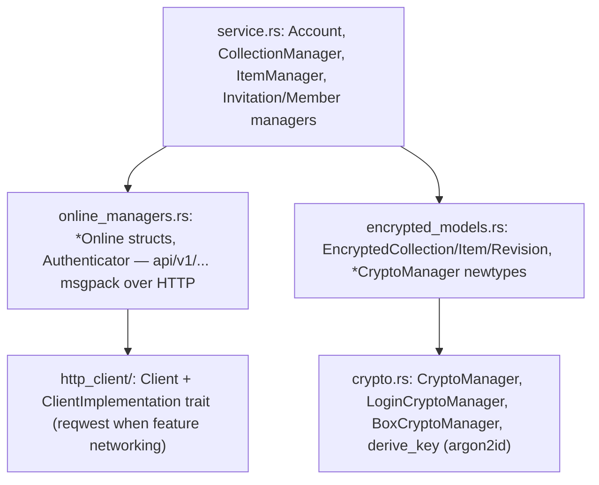

# Repository Guidelines

## Project Overview
`etebase` (crates.io) is the Rust client library for [Etebase](https://docs.etebase.com), a protocol for end-to-end encrypted storage. Other bindings such as libetebase are built on top of it. It is a library-only crate (`crate-type = ["lib"]`, edition 2018, current version 0.6.1), licensed BSD-3-Clause.

## Architecture & Data Flow
There are four layers. Each one only calls the layer below it:



- **The API is fully synchronous.** There is no `async` anywhere, and reqwest uses its `blocking` client. Managers share `Arc<Client>` and `Arc<*CryptoManager>`.
- **Key hierarchy:** `CryptoManager::new(key, 8-byte context, version)` derives five subkeys: cipher, mac, asym seed, subderivation and deterministic.
  - Contexts are `"Main    "`, `"Stor    "`, `"Acct    "`, `"Col     "` and `"ColItem "`. They must stay exactly 8 bytes, space-padded.
  - The item key is `derive_subkey(uid)` unless an explicit `encryption_key` is set.
- **Signup:**
  1. Generate a 32-byte random salt. `derive_key` uses only `salt[..16]`.
  2. Build the main crypto manager and the login keypair.
  3. Encrypt `account_key ‖ identity privkey`.
  4. Call `Authenticator::signup` and store the token with `client.set_token`.
- **Login:**
  1. Get the login challenge.
  2. Sign the msgpack `LoginBodyResponse`.
  3. Call `Authenticator::login` and decrypt the account key.
  4. If the server returns `Unauthorized("User not properly init")`, fall back to signup.
- **Content** (`EncryptedRevision::set_content`):
  - Content is split by a rollsum chunker (`chunker.rs`), with chunks between 16 and 64 KiB.
  - Each chunk is named by its base64 MAC. Chunks are deduplicated and shuffled.
  - When there is more than one index, an index header chunk is appended.
  - Each chunk is padded with padme padding (`buffer_pad`), then encrypted.
- **Metadata** is encrypted detached, with additional data = a MAC over (deleted flag, uid, chunk hashes). The revision uid, used as the etag, is that tag in base64.
- **Uploads:**
  - `upload` creates the object if `_is_new()` (no etag) and otherwise sends a batch. The `transaction` variants add server-side conflict checks.
  - On success, `mark_saved()` sets the `RefCell` etag.
- **Serialization:**
  - Wire bodies use `rmp_serde::to_vec_named` with `camelCase` and `serde_bytes`.
  - The cache format (`CachedContent{version:1, data}`) uses positional `rmp_serde::to_vec`, so **field order is wire format**.
  - Base64 is URL-safe with no padding.
- **Byte compatibility is mandatory.** Data already on servers must decrypt identically after any change to crypto, padding, chunking or serialization.

## Key Directories
- `src/`: the library. `lib.rs` defines the public surface through re-exports, and most modules are private.
- `src/http_client/`:
  - `mod.rs` holds `Client`.
  - `client_impl.rs` holds the `ClientImplementation` trait and `Response`.
  - `reqwest_client.rs` holds the default backend.
- `tests/`: integration tests that need a live server. `tests/common/mod.rs` has the fixtures.
- `examples/etebase_test.rs`: CLI example for login and listing.
- `scripts/wait-for-it.sh`: vendored TCP wait script, used only in CI.
- `.github/workflows/`: `push.yml` defines the jobs, and `test.yml` is a reusable test workflow.

## Development Commands
```sh
cargo build
cargo build --no-default-features              # without reqwest; only Client::new_with_impl exists
cargo fmt --all -- --check                     # CI gate
cargo clippy --all-features --all-targets -- -D warnings   # CI gate; warnings fail
cargo run --example etebase_test -- USER PASS SERVER_URL [COLLECTION_UID]
```
Native dependencies:
- Crypto is `libsodium-rs` over `libsodium-sys-stable`, which builds its bundled libsodium (1.0.22) from C source, so a C compiler is needed.
- `openssl-sys` needs the OpenSSL dev headers and `pkg-config`.

## Code Conventions & Common Patterns
- **Errors:** return `error::Result<T>` with `error::Error`, which is `Clone + PartialEq`.
  - Wrap crypto failures with `to_enc_error!`, which produces `Error::Encryption`.
  - HTTP status codes become errors in `Response::error_for_status`: 401, 403, 404, 409 and 5xx.
  - `From<io::Error>` maps to `UrlParse`. This is a known quirk; don't rely on it.
- **Pluggable HTTP:** implement `ClientImplementation` (`get`, `post`, `put`, `patch`, `delete`). Each method returns a `Response`, not a `Result`.
  - Gate reqwest-specific code with `#[cfg(feature = "networking")]`.
  - `Client` normalizes URLs to http/https with a trailing `/`.
- Call `etebase::init()` (which runs `libsodium_rs::ensure_init`) before any crypto, including in unit tests (`crate::init()`).
- **Lints:** `#![warn(clippy::all)]` and `#![allow(clippy::unnecessary_wraps)]` are set in `lib.rs`. There is no rustfmt or clippy config file, so defaults apply.
- **Keep these as they are:**
  - The trait name `MsgPackSerilization`, misspelled on purpose because renaming it breaks the API.
  - The deprecated aliases (`from_username`, `as_result`, `Account::is_etebase_server`) until the next major release.
- There is no `unsafe` in `src/`; keep it that way.
- `test_helpers` (`test_reset`, `chunk_uids`) is `#[doc(hidden)]` and only for tests. It is not public API.
- **Public API changes:** add re-exports in `lib.rs`. Breaking changes are planned in `TODO.md`, for example key arguments `[u8]` → `[u8; 32]`.

## Important Files
- `src/lib.rs`: re-exports, `init()`, `CURRENT_VERSION`, `DEFAULT_SERVER_URL`.
- `src/service.rs`: the high-level API (`Account::signup/login/restore/save`, managers).
- `src/online_managers.rs`: REST endpoints, `FetchOptions`, list responses, `test_reset`.
- `src/encrypted_models.rs`: encrypted object formats and the MAC/additional-data construction.
- `src/crypto.rs`, `src/utils.rs`: primitives, padding, base64 and randomness. Both contain unit tests.
- `src/fs_cache.rs`: the public on-disk cache.
- `Cargo.toml`: the `networking` feature (default), dependencies and `rust-version`.
- `ChangeLog.md`, `TODO.md`.

## Runtime/Tooling Preferences
- Use Cargo only, with a stable toolchain. There is no `rust-toolchain` file.
- **MSRV:** `rust-version = "1.88.0"` must match in three places: `Cargo.toml`, `README.md` and the `push.yml` comment. It is set by the highest `rust-version` among resolved dependencies (the `icu_*` crates).
- CI also tests on the MSRV with `cargo +nightly generate-lockfile -Z minimal-versions`. Don't raise dependency minimums carelessly.
- `.gitignore` excludes `Cargo.lock` (library convention), even though a copy exists locally.
- Any change to the crypto backend or libsodium version must keep `src/golden_vectors.rs` passing unchanged (values recorded with the old sodiumoxide/libsodium 1.0.18 build); never re-record its values or `src/golden_vectors/collection.msgpack`.
- **ChangeLog:**
  - Add entries under `## Unreleased`, using the subsections `### Features`, `### Fixes` and `### Changes`, one `*` bullet each.
  - Put identifiers in backticks and cite RUSTSEC or CVE IDs.
- **Commits:** short, imperative and capitalized, with no prefix or trailing period. Example: `Bump reqwest to 0.12 to fix RUSTSEC-2026-0258`.

## Testing & QA
Use the standard libtest harness. Integration tests **require a live test server** and **must run single-threaded**, because they share fixed accounts (`test_user` and `test_user2`).
```sh
docker run -p 3735:3735 -d ghcr.io/nikossvnk/etesync-server/test-server:latest   # amd64 + arm64
export ETEBASE_TEST_HOST=localhost:3735        # test_url() panics if unset
cargo test -- --test-threads=1
cargo test --test service collection_invitations -- --test-threads=1   # single test
cargo test --lib                                # unit tests in crypto.rs/utils.rs, no server
cargo test -- --ignored --test-threads=1        # #[ignore] tests (account reset can't wipe)
```
- Test functions return `etebase::error::Result<()>` so they can use `?`. Use `assert_err!(expr, Pattern)` (in `tests/service.rs`) to check that a call fails with a given error variant.
- Network tests start with `init_test(&USER)`, which resets the user, restores the session and fetches a token. They usually end with `logout()`.
- `tests/fs_cache.rs` does not reset the user, so it assumes `test_user` already exists on the server.
- Fixtures are fixed base64 constants in `tests/common/mod.rs`. Never generate them at runtime.
- There are no coverage tooling or targets. CI runs `cargo test --no-fail-fast -- --test-threads=1` on both stable and the MSRV with minimal versions, plus the fmt and clippy gates.
